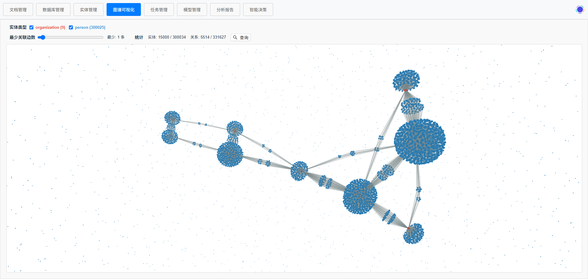

# OpenPalantir

LLM Wiki + 受控本体 + 知识图谱 | 把企业文档与数据库变成可编辑、可溯源、可分析的知识资产

[](https://opensource.org/licenses/MIT)
[](https://www.python.org/downloads/)
[](https://nodejs.org/)
[](https://react.dev/)

<p align="center">
  
</p>

> **Logo 释义**：中央的水晶球象征 Palantir——洞悉世间万物、洞察数据真相；环绕四周的五本书籍源源不断地为水晶球输送知识与数据，寓意系统从多源异构数据中汲取养分，汇入知识图谱，赋能智能决策。

现成的 RAG 产品把文档切成块做向量召回，答案没有结构、知识没有类型。OpenPalantir 走另一条路：**文档 → 层级摘要树 → 本体约束的图谱 → 由 LLM 写成的 Wiki 页面**，四条能力叠在一起，构成一个可自部署的开源「内部 Palantir」。

- **LLM Wiki**：不是把摘要树换个皮。跨文档同主题的内容由 LLM **聚合改写**成一页，页面是可编辑的一等内容资产，问答的高质量回答可一键**发布为页面**，每处结论带 `node_id` 引用锚点可回跳原文。
- **受控本体（Ontology）**：实体类型、关系谓词、定义域/值域全部来自可插拔的 YAML 本体包。任意 LLM 输出先归一化到受控 key 再算 ID，`MATCH ()-[r:任职于]->()` 这类查询才成立；内置 general/workforce/finance/medical 四包，社区包用 `extends` 挂在它们之上只写增量。
- **图谱分析**：路径、社区发现、中心性、趋势，写入与查询共用同一套类型化边。
- **多源接入与增量运营**：PDF/Word/Markdown/图片（MinerU + OCR）、MySQL/PostgreSQL/SQLite 全量导入，Debezium CDC 管数据库行级变更，内容 hash 管文档变更——改一篇文档，相关摘要节点、图谱实体与 Wiki 页面自动标记失效并重生成。

<p align="center">
  
</p>

## 一键看效果

后端 + Neo4j + 一个可用模型就绪后：

```bash
python scripts/demo/run_demo.py
```

它会把 `examples/docs` 的三篇同主题示例文档跑完整条链路（摘要树 → 按 `rd_efficiency` 本体域抽取 → 生成 Wiki 页面 → 打印治理报告），素材与参数说明见 [examples/README.md](examples/README.md)。

## 功能特性

| 能力 | 说明 |
|------|------|
| 层级摘要 | PageIndex 式摘要树：文档级描述 + 节点级摘要 + 原文双字段，Wiki 与问答的素材层 |
| LLM Wiki 生成 | 文档页 / 跨文档主题页 / 本体实体页三级，支持流式与分节续写长文 |
| 页面编辑与发布 | `GET/PUT/DELETE /api/wiki/pages`，draft/published 状态，问答答案可发布为新页面 |
| 引用溯源 | `/api/decision/ask` 支持 `scope`（页面/文档）与 `citations`，前端渲染为可点击锚点 |
| 混合检索 | 摘要树推理式导航 + Neo4j 全文 + embedding 重排，统一入口在 `agentic/seed_retriever` |
| 本体注册表 | YAML 包加载即校验，`version` 驱动 prompt 缓存失效，导入社区包无需重启 |
| 谓词归一化 | exact key → 别名 → 兜底「其他」并保留原始谓词，归一化先于 relationship_id |
| 本体治理 | `GET /api/ontology/report`：词表使用率、非法类型、定义域/值域违规、游离实体、别名候选 |
| 图谱分析 | 路径 / 社区 / 中心性 / 趋势 |
| CDC 增量同步 | Debezium Server + Redis Streams，位点连续性与全量位点对齐 |
| 文档变更监听 | 内容 hash 比对 + 可选轮询监听，失效传播到图谱与 Wiki |
| 交互式可视化 | D3.js 图谱可视化，节点/边交互与 3D 展示，按本体类型着色 |

## 技术栈

| 层级 | 技术 |
|------|------|
| 前端 | React 18 + TypeScript + Vite + Ant Design 5 + D3.js |
| 后端 | FastAPI + Python 3.10+ |
| 图数据库 | Neo4j 4.4+ |
| 任务队列 | Celery + Redis |
| CDC 增量同步 | Debezium Server 3.5.2 + Redis Streams |
| 元数据库 | SQLite（含 Wiki 页面与本体包数据） |
| 本体定义 | YAML 本体包（`backend/ontology/packs/`） |
| 图谱分析 | NetworkX + scikit-learn |
| LLM 集成 | Ollama / OpenAI / DeepSeek / SiliconFlow（含 embedding） |

## 系统架构

```
┌─ 前端 (React + TypeScript + Vite) ─────────────────────────┐
│  标签导航：文档 / DB / 实体 / 图谱 / 任务 / 模型 / 分析 /     │
│  Wiki / 智能决策      → Axios → 后端 REST API               │
└────────────────────────────────────────────────────────────┘
         ↕ HTTP
┌─ 后端 (FastAPI + Python) ──────────────────────────────────┐
│  api/routes/      → 各模块 router（含 wiki / ontology）      │
│  pageindex/       → 层级摘要树                              │
│  ontology/        → 本体注册表 · 谓词归一化 · 治理 · prompt   │
│  wiki/            → 页面生成（文档页 / 主题页 / 实体页）      │
│  decision_engine/ → ReAct 循环 + 混合检索 + 记忆 + Skill/MCP │
│  task_manager/    → 异步任务队列（状态追踪）                 │
│  cdc/             → Debezium 增量同步                       │
└────────────────────────────────────────────────────────────┘
         ↕
┌─ 存储层 ───────────────────────────────────────────────────┐
│  SQLite (元数据 + Wiki 页面) | Neo4j (类型化边图关系)         │
│  Redis Streams (CDC) | 文件系统 (data/summaries, 本体包)     │
└────────────────────────────────────────────────────────────┘
         ↕
┌─ 外部服务 ─────────────────────────────────────────────────┐
│  Debezium Server (Quarkus) → 源DB binlog/WAL → Redis        │
│  MinerU (PDF 解析) · Ollama (LLM / embedding)               │
└────────────────────────────────────────────────────────────┘
```

数据如何流转（文档分析、数据库导入、CDC、本体链路的逐段说明）见 [docs/data-flow.md](docs/data-flow.md)。

## 快速开始

### 环境要求

- Python 3.10+
- Node.js 18+
- Neo4j 4.4+
- Redis 6+
- 一个 LLM：本地 Ollama（`bash scripts/download_models.sh`）或任意 OpenAI 兼容 API

### 安装与运行

```bash
git clone https://github.com/your-org/OpenPalantir.git
cd OpenPalantir

# 后端
cd backend
cp .env.example .env   # 编辑 .env 填入你的配置
pip install -r requirements.txt
uvicorn main:app --reload --port 8000

# 前端
cd frontend
npm install
npm run dev             # 端口 5175
```

访问 http://localhost:5175 打开应用，http://localhost:8000/docs 查看 API 文档。

然后：在「模型管理」新增并启用一个模型 → 「文档管理」添加文档源指向 `examples/docs` → 生成概要 → 提取实体关系（选本体域）→ 「知识Wiki」看生成的页面 → 「智能决策」提问并查看引用。或者直接 `python scripts/demo/run_demo.py` 把这段手活自动化。

### 使用 Docker（推荐）

```bash
docker-compose up -d
```

## 项目结构

```
OpenPalantir/
├── backend/                # FastAPI 后端
│   ├── api/routes/         # REST API 端点（含 wiki.py / ontology.py）
│   ├── analysis_engine/    # 图谱分析引擎
│   ├── cdc/                # Debezium 增量同步 (CDC)
│   ├── config/             # 数据库 & Neo4j 配置
│   ├── database_management/# 外部数据库连接管理与 Schema 标注
│   ├── decision_engine/    # ReAct 循环 / 检索 / 记忆 / Skill+MCP
│   ├── document_processing/# 文档解析与层级摘要（PDF/Word/MD/图片）
│   ├── entity_extraction/  # 实体识别（LLM 增强，词表来自本体）
│   ├── file_sources/       # 文件源抽象与变更监听
│   ├── knowledge_graph/    # Neo4j 图操作（类型化边、来源回收）
│   ├── model_management/   # LLM 模型客户端（含 embedding、流式）
│   ├── models/             # SQLAlchemy ORM 模型与资源 ID
│   ├── ontology/           # 本体注册表 / 谓词归一化 / 治理 / prompt
│   │   └── packs/          # 内置本体包 YAML
│   ├── pageindex/          # 文档摘要树
│   ├── source_management/  # 文档源处理与失效重生成
│   ├── wiki/               # Wiki 页面生成与服务
│   ├── system/             # 日志 & 系统集成
│   ├── task_management/    # 异步任务管理
│   └── utils/              # 工具函数
├── frontend/               # React 前端（Wiki 与智能决策标签页）
├── examples/               # 示例文档 + 示例社区本体包
├── scripts/                # 安装、服务管理与 demo 脚本
├── tests/                  # 测试
├── openspec/               # 规格与变更提案流程
└── docs/                   # 设计文档
```

## 目标场景

| 场景 | 谁在用 | 依赖能力 |
|------|--------|---------|
| 企业文档知识门户 | 团队把制度/手册/报告上传即成 Wiki，问答带引用溯源 | 摘要树 + Wiki 生成 + 混合检索 |
| 领域知识图谱构建 | 制造/医疗/金融领域用受控本体从多源文档抽取规范化关系 | 本体层 + 抽取管线 |
| 数据资产语义层 | 关系库 Schema 本体标注，业务人员问实体关联 | Schema 标注 + 本体层 |
| 增量知识运营 | DB 变更（CDC）与文档变更共同驱动图谱与 Wiki 刷新 | 内容 hash + 失效传播 |

## 文档

- [本体指南](docs/ontology-guide.md) — 本体包怎么写、怎么改落库数据、治理报告怎么读
- [示例与一键 demo](examples/README.md)
- [效果展示](docs/screenshots.md)
- [安装指南](INSTALL.md)
- [用户指南](docs/user-guide.md)
- [架构设计](docs/architecture.md)
- [API 参考](docs/api-reference.md)
- [数据流说明](docs/data-flow.md)
- [开发指南](docs/development-guide.md)
- [CDC 设置](docs/cdc-setup.md)
- [贡献指南](CONTRIBUTING.md)
- [行为准则](CODE_OF_CONDUCT.md)
- [安全政策](SECURITY.md)
- [变更日志](CHANGELOG.md)

## 贡献

领域本体包是最欢迎的贡献方式——`extends` 一个内置域包、只写你的增量，导入即校验、校验即生效。提案流程见 [CONTRIBUTING.md](CONTRIBUTING.md) 与 `openspec/`。

## 许可证

本项目基于 MIT 许可证开源。详见 [LICENSE](LICENSE) 文件。

OpenPalantir is open source software licensed under the [MIT License](LICENSE).
